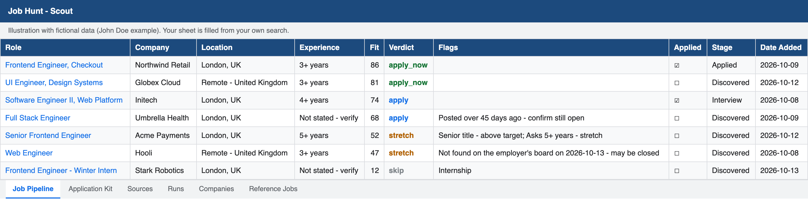
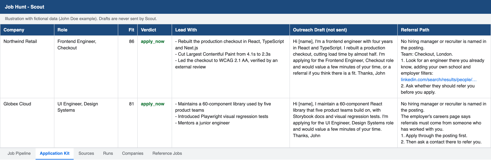
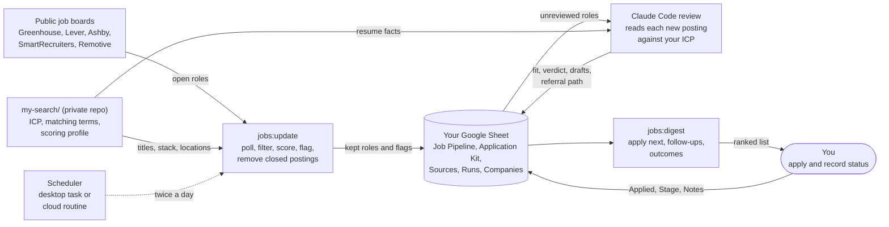
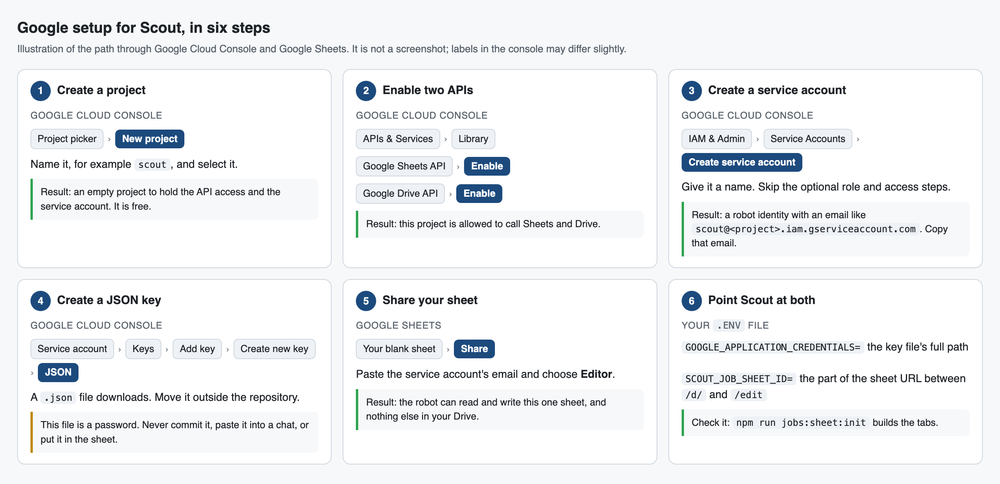
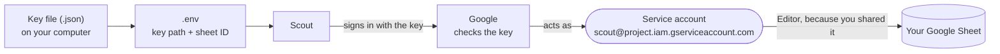
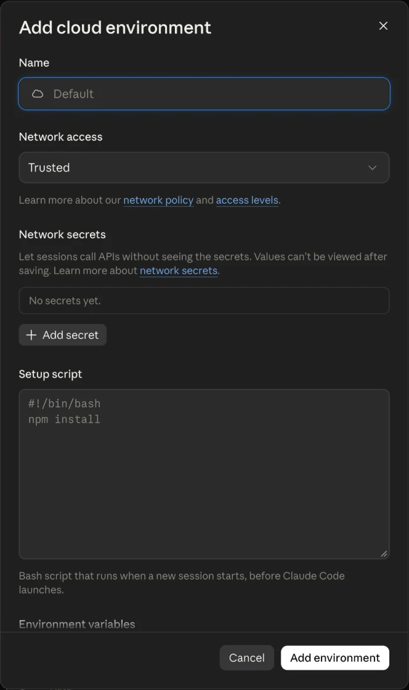

# Scout

Scout is a private job-search pipeline. It polls company job boards, keeps the
roles that match what you are looking for, ranks them against your real
experience, drafts what you need to apply, and tracks what happens next. The
results live in a Google Sheet you own.

It is built to be reused. Everything about one person's search lives in three
files in a `my-search/` folder that Git ignores, so the same code serves any
role, stack, city, or experience level, and your profile never ends up in a
shared repository.

Scout never applies, never contacts anyone, and never invents a contact. It
prepares; you send.

## What you get

A Google Sheet with these tabs:

| Tab             | What it holds                                                    |
| --------------- | ---------------------------------------------------------------- |
| Job Pipeline    | Open roles that match, with fit score, verdict, flags, and dates |
| Application Kit | Per role: resume evidence, an outreach draft, a referral path    |
| Sources         | The job boards Scout polls                                       |
| Runs            | A record of every refresh                                        |
| Companies       | Employers to probe for job boards                                |
| Reference Jobs  | Leads that could not be verified                                 |

Each refresh updates the pipeline, removes postings that have closed, and leaves
your own columns (Applied, Application Date, Stage, Next Action, Notes) alone.

**Job Pipeline** ranks every open role and flags what differs from your target:



**Application Kit** holds what you need to apply to each role:



Both images are illustrations with fictional data from the John Doe example, not
a real person's sheet. They show a selection of the columns.

## How it fits together



Scout reaches the sheet with a Google service-account key. Claude does the one
step code cannot: reading a posting against your real experience. Nothing in the
loop applies, sends a message, or contacts anyone.

## Quick start

You need Node.js 22.9 or newer, a Google account, and
[Claude Code](https://claude.com/claude-code). Fork
[Hritvik-Mohan/scout](https://github.com/Hritvik-Mohan/scout) so your profile
stays yours, clone your fork, switch to the
[latest release](https://github.com/Hritvik-Mohan/scout/releases/latest), and
open the folder in Claude Code:

```bash
git clone https://github.com/<you>/scout.git
cd scout
git checkout -b my-search "$(git describe --tags --abbrev=0)"
claude
```

That starts you on a branch of your own at the newest released version, rather
than on unreleased work. [Versions and upgrading](#versions-and-upgrading)
explains how to move to a newer release later.

Then paste this prompt. It does the whole setup with you. The only steps it
cannot do for you are creating the Google key and sharing the sheet, and it
walks you through both.

```text
Set up this Scout repository for my own job search. Read README.md first.

1. Prepare the project. Check that Node.js is 22.9 or newer and tell me how to
   upgrade if it is not. Run `npm ci`. If there is no .env file, copy
   .env.example to .env. Never print the contents of .env.
2. Interview me. Ask for my resume (a file path or pasted text), then ask, a
   few questions at a time: the titles I want, titles and specialisms to
   exclude, my seniority ceiling, the cities I will work in, which countries'
   remote roles I can legally take, my core stack, and anything I refuse.
3. Create my search. Copy examples/john-doe to my-search (it is ignored by
   Git). Rewrite my-search/job-search-icp.md following docs/icp-template.md,
   with the John Doe file as a model of the finished result, using only facts
   from my resume and my answers. Never invent experience, numbers, or skills.
   Where my resume and my stated goals disagree (for example years under my
   current title versus years I claim), say so in the "Resume facts" section
   and tell me. Do not copy my phone number, email, or home address into any
   file.
4. Rewrite my-search/job-search.json for my search: role titles, excluded and
   too-senior titles, maxLevel, stack terms, cities, remote-eligible terms and
   experience limits. Update my-search/jobs.json so its id, name, description,
   targetEntity, geographyPriority and criterion descriptions describe me,
   keeping the criterion ids unchanged.
5. Run `npm run jobs:config:check` and fix what it reports. Run
   `npm run check`.
6. Back up my search in a private repository. my-search/ is ignored by this
   repository's Git, so make it a repository of its own. Check that the GitHub
   CLI works (`gh auth status`). Ask me to confirm the name, defaulting to
   <my GitHub username>/scout-search. Then, inside my-search/, run `git init`,
   commit the files, and run
   `gh repo create <name> --private --source=. --remote=origin --push`.
   Confirm the new repository is private and tell me its URL. Never create it
   as public. If `gh` is missing or not signed in, show me the manual steps
   from the README's "Keep your search in a private repository" and continue.
7. Walk me through the README's "Create a Google service-account key" and
   "Create the sheet" steps one at a time, and wait while I do each. I will put
   the key path and sheet ID in .env myself. Never ask me to paste the key.
8. Run `npm run jobs:sheet:init`. Then help me fix the Sources tab for my
   market: deactivate boards that do not fit, and add public Greenhouse, Lever,
   Ashby or SmartRecruiters boards for companies I name.
9. Run `npm run jobs:update` and report sources checked, failures, and roles
   discovered, kept, inserted and pruned.
10. Run `npm run jobs:review:pending`, review each pending role against my ICP
   following the README's "Review rules", and apply the reviews.
11. Show me `npm run jobs:digest`, explain how to record an application in the
    sheet, and offer to schedule the refresh as described under "Schedule it".

Never submit an application, contact anyone, or invent a contact detail.
```

The rest of this README explains what that prompt sets up, for doing it by hand
or changing it later.

## Make it yours

Three files define a search. They live in `my-search/`, which Git ignores, so
they stay on your machine and never conflict with updates to Scout.

| File                          | What it controls                                                                                         |
| ----------------------------- | -------------------------------------------------------------------------------------------------------- |
| `my-search/job-search.json`   | Matching terms: role titles, excluded titles, stack words, cities, remote regions, experience ceiling    |
| `my-search/jobs.json`         | Scoring: which criteria are required, their weights, and the keep and action thresholds                  |
| `my-search/job-search-icp.md` | Your ideal-role profile and resume facts, which the review step uses to rank roles and write your drafts |

Create the folder from the fictional example, John Doe, a mid-level frontend
engineer in London, then make the files yours:

```bash
cp -R examples/john-doe my-search
```

[How to write your ICP](#how-to-write-your-icp) explains the third file. To keep
the files somewhere else, set `SCOUT_JOB_SEARCH_PATH`, `SCOUT_PROFILE_PATH`, and
`SCOUT_ICP_PATH`.

### Keep your search in a private repository

`my-search/` is ignored by Scout's Git, so on its own it exists only on your
computer. Make the folder a private repository of its own. That backs it up,
keeps its history, and lets a cloud routine read it without your profile ever
entering a public repository.

```bash
cd my-search
git init -b main
git add -A
git commit -m "Add my Scout search files"
gh repo create <you>/scout-search --private --source=. --remote=origin --push
cd ..
```

Without the GitHub CLI, create an empty **private** repository on github.com,
then run `git remote add origin <its URL>` and `git push -u origin main` inside
`my-search/`.

After editing your files, send them to the private repository with one command:

```bash
npm run jobs:search:sync
```

It commits any changes in `my-search/` and pushes them. Cloud runs read the
pushed version, so `npm run jobs:update` warns you when your local files are
ahead of it.

On another computer, clone it back into place:

```bash
git clone https://github.com/<you>/scout-search.git my-search
```

### `my-search/job-search.json`

Every term is matched as a lowercase substring.

| Field                                 | Meaning                                                                   |
| ------------------------------------- | ------------------------------------------------------------------------- |
| `roleTitles`                          | A job title must contain one of these                                     |
| `nonDevelopmentTitles`                | Titles that are not your kind of role, such as QA or support              |
| `specialistTitles`                    | Specialisms you are not targeting                                         |
| `tooSeniorTitles`                     | Title fragments that mean too senior, such as `principal`                 |
| `maxLevel`                            | Highest numbered level to keep: `2` keeps "SDE II" and drops "SDE III"    |
| `technicalTerms`                      | Stack and domain words; two or more in a posting prove technical fit      |
| `systemsTerms`, `platformTerms`       | Words that earn bonus signals                                             |
| `primaryLocations`                    | Cities you will work in                                                   |
| `remoteEligibleTerms`                 | Location words that make a remote role open to you, such as your country  |
| `primaryLocationLabel`, `remoteLabel` | Display names; each must appear in `geographyPriority` in the profile     |
| `maxYears`, `hardMaxYears`            | Years asked above which a role stops fitting, and at which it is rejected |

### `my-search/jobs.json`

Keep the criterion ids; the assessor reports against them. Change the
descriptions, weights, `required` flags, `geographyPriority`, and thresholds.
[`docs/profile-format.md`](docs/profile-format.md) documents the format.

After editing either file, check them:

```bash
npm run jobs:config:check
```

## Manual setup

These are the steps the quick-start prompt performs, for doing them yourself.

### 1. Get the code

Fork [Hritvik-Mohan/scout](https://github.com/Hritvik-Mohan/scout) so your
profile stays yours, then start a branch of your own at the latest release:

```bash
git clone https://github.com/<you>/scout.git
cd scout
git checkout -b my-search "$(git describe --tags --abbrev=0)"
npm ci
cp .env.example .env
```

### 2. Create a Google service-account key

Scout reads and writes the sheet as a service account, a robot Google identity
with its own key. You create it once in Google Cloud. It is free, and it takes
about ten minutes. Steps 2 and 3 of this guide together look like this:



The image is an illustration of the path, not a screenshot. How the pieces
connect once it is done:



The key proves Scout is the service account. Sharing the sheet is what lets that
account in. Both halves are needed.

1. Open the [Google Cloud Console](https://console.cloud.google.com) and
   [create a project](https://console.cloud.google.com/projectcreate), for
   example `scout`. Make sure it is the selected project at the top of the page.
2. Go to **APIs & Services > Library** and enable two APIs:
   [Google Sheets API](https://console.cloud.google.com/apis/library/sheets.googleapis.com)
   and
   [Google Drive API](https://console.cloud.google.com/apis/library/drive.googleapis.com).
   Open each one and press **Enable**.
3. Go to
   [**IAM & Admin > Service Accounts**](https://console.cloud.google.com/iam-admin/serviceaccounts)
   and choose **Create service account**. Give it a name and finish. Skip the
   optional steps about roles and user access; it needs none.
4. Open the new service account, go to the **Keys** tab, and choose **Add key >
   Create new key > JSON**. A `.json` file downloads. You cannot download the
   same key again, only create a new one.
5. Move that file outside the repository and restrict it:

   ```bash
   mkdir -p ~/.config/scout
   mv ~/Downloads/<downloaded-key>.json ~/.config/scout/service-account.json
   chmod 600 ~/.config/scout/service-account.json
   ```

6. In `.env`, set `GOOGLE_APPLICATION_CREDENTIALS` to that absolute path.

Note the service account's email address, shown on its page and in the key file
as `client_email`. You share the sheet with it in the next step.

If key creation is blocked with a message about an organization policy, the
project belongs to a Workspace organization that forbids keys. Create the
project under a personal Google account instead, or ask the administrator.

Treat the key like a password. Never commit it, paste it into a chat, or put it
in the sheet.

### 3. Create the sheet

1. Create a blank Google Sheet in your own account.
2. Share it with the service account's email address as an **Editor**.
3. Copy the sheet ID from its URL, the part between `/d/` and `/edit`, into
   `SCOUT_JOB_SHEET_ID` in `.env`.
4. Build the tabs:

   ```bash
   npm run jobs:sheet:init
   ```

If that command fails, the message says which half is missing:

| Message contains                         | Cause                                                                      | Fix                                                                        |
| ---------------------------------------- | -------------------------------------------------------------------------- | -------------------------------------------------------------------------- |
| `HTTP 403`                               | The sheet is not shared with the service account, or an API is not enabled | Share the sheet as Editor; enable both APIs in the same project as the key |
| `HTTP 404`                               | The sheet ID is wrong                                                      | Copy the part of the URL between `/d/` and `/edit`                         |
| `Could not load the default credentials` | The key path in `.env` is wrong or missing                                 | Set `GOOGLE_APPLICATION_CREDENTIALS` to the full file path                 |
| `invalid_grant` or `Invalid JWT`         | The key was deleted or the clock is wrong                                  | Create a new key; check your computer's date and time                      |

To retire a key, delete it under the service account's **Keys** tab and create a
new one. Scout uses whichever file `.env` points to.

### 4. Describe your search

1. Create your search folder from the example:

   ```bash
   cp -R examples/john-doe my-search
   ```

2. Rewrite `my-search/job-search-icp.md` for yourself, following
   [`docs/icp-template.md`](docs/icp-template.md), and edit the two JSON files
   for your own titles, stack, and locations.
3. Run `npm run jobs:config:check` until it reports no problems.

### 5. Choose your sources

`jobs:sheet:init` fills the **Sources** tab with a starter list aimed at
Bengaluru. Edit that tab for your market:

- Untick **Active** on boards you do not want. Do not delete starter rows;
  re-running `jobs:sheet:init` would add them back.
- Add a row for each company board you do want. Scout can poll these types:

  | Type              | URL to enter                                                 |
  | ----------------- | ------------------------------------------------------------ |
  | `greenhouse`      | `https://boards-api.greenhouse.io/v1/boards/<board>/jobs`    |
  | `lever`           | `https://api.lever.co/v0/postings/<company>?mode=json`       |
  | `ashby`           | `https://api.ashbyhq.com/posting-api/job-board/<board>`      |
  | `smartrecruiters` | `https://api.smartrecruiters.com/v1/companies/<id>/postings` |
  | `remotive`        | `https://remotive.com/api/remote-jobs`                       |

  The board name is the last part of a company's careers URL, for example
  `jobs.lever.co/<company>`.

- Or list employers in the **Companies** tab (name in column B) and let Scout
  find their boards:

  ```bash
  npm run jobs:sources:discover
  ```

### 6. First run

```bash
npm run jobs:update
```

Then rank what it found. In Claude Code, from the repository folder, say:

> Run `npm run jobs:review:pending`, review every pending role against
> `my-search/job-search-icp.md` following the review rules in the README, apply
> the reviews, and show me `npm run jobs:digest`.

## How to write your ICP

"ICP" is borrowed from sales, where it means ideal customer profile. Here it is
your ideal-role profile: a short document stating what you want and what you can
prove. The review step treats it as the truth about you, so a vague or
flattering ICP produces a vague or flattering ranking.

Start from [`docs/icp-template.md`](docs/icp-template.md). The rules that
matter:

- **Write only what your resume can back up.** Every claim should trace to a
  bullet a recruiter can check.
- **Be exact about time.** Give each role's title and start and end month. If
  you have three years of experience but one under your current title, say so.
  Recruiters count title tenure, and the ranking should too.
- **Separate production from practice.** A simulator, a prototype, or a course
  project is real work, but it is not operating a system at scale. Say which is
  which.
- **List what you lack.** Name the common requirements you do not meet. The
  review then reports them as gaps instead of ranking a role you cannot get.
- **Tier your targets.** Say which titles you would take today, which are
  adjacent, and which are a stretch.
- **Be specific about location.** Name the cities, and the remote regions you
  can legally work for. "Remote" alone is not an answer.
- **Map needs to evidence.** For each requirement that recurs in postings, note
  the one resume bullet that proves it. Drafts are built from this table.
- **Leave unknowns as unknowns.** If you have not decided your pay floor, write
  that rather than guessing.

Update the ICP whenever your resume changes, then re-run the review with
`npm run jobs:review:pending -- --all`.

## Daily use

| Command                                       | What it does                                                    |
| --------------------------------------------- | --------------------------------------------------------------- |
| `npm run jobs:update`                         | Poll every active source and update the pipeline                |
| `npm run jobs:review:pending`                 | Export roles awaiting review (`-- --all` to re-review them all) |
| `npm run jobs:review:apply -- <reviews.json>` | Write reviews and drafts to the sheet                           |
| `npm run jobs:digest`                         | Print what to apply to next, follow-ups due, and outcomes       |
| `npm run jobs:outcomes`                       | Print responses and interviews by verdict, level, and source    |
| `npm run jobs:sources:discover`               | Probe employers in the Companies tab for job boards             |
| `npm run jobs:config:check`                   | Validate the three files in `my-search/`                        |
| `npm run jobs:search:sync`                    | Commit and push `my-search/` to your private repository         |
| `npm run check`                               | Format, lint, typecheck, test, and build                        |

When you apply to a role, tick **Applied**, set **Application Date**, and keep
**Stage** current. Follow-up reminders and outcome tracking read those columns,
and an applied role is never removed.

### Review rules

The keyword score only decides what is kept. Ranking comes from a review of each
posting against your ICP, written by Claude or by you as JSON matching
`jobReviewSchema` in [`src/jobs/review.ts`](src/jobs/review.ts):

- `fit`: 0 to 100. Use the whole range, and weigh the years asked against your
  title tenure.
- `verdict`: `apply_now`, `apply`, `stretch`, or `skip`.
- `reasons` (1 to 3) and `gaps` (0 to 3): specific to the posting.
- `leadWith` (0 to 5): resume evidence, taken only from the ICP.
- `outreach`: a draft under 100 words addressed to "[name]".
- `referralPath`: for `apply_now` roles, what the posting and the employer's
  official pages say about the team and referral rules, plus a people-search
  link for you to run. It never lists individual employees or guesses a contact.

## Set up Claude Code

Claude Code is the assistant that runs the setup prompt, reviews roles against
your ICP, and runs the refresh on a schedule. It comes as a desktop app, a
terminal command, and a web app at <https://claude.ai/code>; install it from
<https://claude.com/claude-code> and sign in.

| You want to                         | Use                                            |
| ----------------------------------- | ---------------------------------------------- |
| Run the setup prompt                | Desktop app or terminal, opened in this folder |
| Review roles and see the digest     | Desktop app or terminal, opened in this folder |
| Refresh on a schedule, computer on  | Desktop app scheduled task                     |
| Refresh on a schedule, computer off | Cloud routine at <https://claude.ai/code>      |

To start a session in the terminal, run `claude` inside the repository folder.
In the desktop app, open the Code tab and choose the folder. The first time
Claude runs a command it asks for permission; approve the `npm run` commands
Scout uses.

### Cloud environment

A cloud routine runs in a cloud environment, which holds its settings. Create
one at <https://claude.ai/code> from the environment picker, with **Add
environment**:



| Field                 | What to enter                                                                                                   |
| --------------------- | --------------------------------------------------------------------------------------------------------------- |
| Name                  | Any name, such as `scout`                                                                                       |
| Network access        | A level that allows the job-board APIs and Google Sheets. If runs report blocked requests, widen it             |
| Network secrets       | Leave empty. Scout's code must read the key itself, and these secrets are hidden from the session               |
| Setup script          | Leave empty. The refresh prompt installs dependencies                                                           |
| Environment variables | Scroll down. Two lines, no quotes, no spaces around `=`: `SCOUT_JOB_SHEET_ID` and `GOOGLE_SERVICE_ACCOUNT_JSON` |

The hosts Scout calls are `sheets.googleapis.com`, `oauth2.googleapis.com`,
`boards-api.greenhouse.io`, `api.lever.co`, `api.ashbyhq.com`,
`api.smartrecruiters.com`, and `remotive.com`.

Put the variable name in the **Environment variables** box, not in the **Name**
field. [In the cloud](#in-the-cloud) gives the full steps, including how to copy
the key without displaying it.

## Schedule it

### What Claude needs

Scout reaches Google Sheets with the service-account key, not through a Claude
connector, so you do not need a Google connector in Claude. What each option
needs:

| Where it runs                 | Needs                                                             |
| ----------------------------- | ----------------------------------------------------------------- |
| Claude desktop scheduled task | The app open on a computer that has this folder and its `.env`    |
| Claude cloud routine          | GitHub connected to Claude, your private search repo, two secrets |

Scout needs no GitHub repository secrets. The included CI workflow only runs
`npm run check`, which never touches the sheet. The two secrets for a cloud
routine are environment variables in Claude's cloud environment, not GitHub
Actions secrets; do not add the key to GitHub.

### On your computer

In the Claude desktop app, ask Claude Code to "create a scheduled task that runs
twice a day" with the prompt below. It runs only while the app is open. The
first time, press **Run now** so you can approve the tools it uses.

### In the cloud

A cloud routine runs on Anthropic's servers whether or not your computer is on.
It clones your repository each time, so it has no `.env` and no key file.

1. On <https://claude.ai/code>, connect your GitHub account and give the Claude
   GitHub app access to your Scout repository and your private `scout-search`
   repository.
2. In your cloud environment's settings, add two environment variables:
   - `SCOUT_JOB_SHEET_ID`: your sheet ID.
   - `GOOGLE_SERVICE_ACCOUNT_JSON`: the key file's contents on one line. Copy it
     base64-encoded without displaying it:

     ```bash
     base64 -i ~/.config/scout/service-account.json | tr -d '\n' | pbcopy
     ```

3. Ask Claude Code to "create a cloud routine" with the prompt below, both
   repositories (your Scout fork and your private `scout-search`), and your
   schedule. Tell it to attach no connectors.
4. Run it once and read the result before relying on it.

A cloud run only sees what is on GitHub, and `my-search/` is not in the Scout
repository. Give the routine both repositories: your Scout fork and your private
`scout-search` repository from
[Keep your search in a private repository](#keep-your-search-in-a-private-repository).
The Claude GitHub app needs access to both. They are cloned side by side, and
the refresh prompt copies your files into `my-search/` at the start of each run.

Merge changes to your default branch before expecting a cloud run to use them.

### The refresh prompt

```text
You are maintaining Scout, a job-search pipeline, for the person described in
my-search/job-search-icp.md. Work in the repository root.

Setup: run `npm ci` if node_modules is missing. If there is no .env file, check
that SCOUT_JOB_SHEET_ID and GOOGLE_SERVICE_ACCOUNT_JSON are set, without
printing them; if either is missing, stop and say which.

If the my-search folder is missing, look for a scout-search directory next to
this repository (cloud runs clone it there) and copy job-search-icp.md,
job-search.json and jobs.json from it into my-search. If neither exists, stop
and say so. Never commit or publish anything from my-search or scout-search.

Read my-search/job-search-icp.md, especially "Resume facts". It is the only source
of truth about the candidate. The roles, cities and remote regions to target
are defined there and in my-search/job-search.json.

Steps:
1. Run `npm run jobs:update` and keep its JSON summary.
2. On the first run of each week, run `npm run jobs:sources:discover`; if it
   adds sources, run `npm run jobs:update` again.
3. Run `npm run jobs:review:pending`. If roles are pending, read
   .local/job-reviews/pending.json, review each against the ICP following the
   "Review rules" in README.md, save the array to
   .local/job-reviews/reviews.json, and run
   `npm run jobs:review:apply -- .local/job-reviews/reviews.json`.
4. Run `npm run jobs:digest`.

Rules:
- Never submit applications, contact anyone, or send messages.
- Never invent experience, metrics, skills, names, or contact details.
- Never write to Job Pipeline columns R:V.
- Do not modify source files, commit, or push. Describe needed changes instead.
- Never print or store credentials or the contents of .env.
- If a command fails, stop and report exactly what failed.

Finish with one compact report: the reason this run matters or "No actionable
changes."; the counts from step 1 and how many roles were reviewed; the digest's
"Apply next" list with row numbers, fit, verdict, flags and links; any
follow-ups due; and the outcome summary.
```

## How it works

- **Keep or drop.** Each posting is checked against `my-search/job-search.json`
  and scored with `my-search/jobs.json`. Only `keep` and `action` roles enter
  the sheet, identified by a stable ID so a role is never duplicated.
- **Flags.** Column W marks what differs from your target: a senior title, an
  internship, a data or ML role, a high experience ask, a possible duplicate, or
  a posting older than 45 days.
- **Review.** Fit, verdict, reasons, and gaps go to columns X:AA; drafts go to
  Application Kit.
- **Closed postings.** Greenhouse, Lever, and Ashby feeds list every open role,
  so a role missing from a complete feed is treated as closing. The first miss
  adds a "Not found on the employer's board" flag. On the next miss the row is
  removed with its drafts, unless you have applied or moved its stage; those
  rows stay and are flagged "Closed". A role that reappears returns to normal.
- **Digest.** Open roles are ranked by fit less a penalty for old postings.
  Applications with no recorded response after a week are listed for follow-up.
- **Date Added.** Column AB records when a role first entered the pipeline.

## Location-specific extras

Two commands are tied to Bengaluru data sources and are optional elsewhere:

- `npm run jobs:companies` fills the Companies tab from the public Bangalore
  Startup Map and scans company websites for careers pages and publicly listed
  contacts. `SCOUT_COMPANY_ENRICH_LIMIT` bounds each run.
- `npm run jobs:import:lets-code` imports a Bengaluru job-seeker workbook into
  Companies, Reference Jobs, and Resources.

For another city, put your own employer list in the Companies tab.

## Other profile types

The scoring engine is not limited to jobs. `profiles/sales-leads.json` and
`profiles/freelance.json` are starter profiles for other searches:

```bash
npm run build
npm run profile:validate -- profiles/freelance.json
npm run profile:score -- profiles/freelance.json examples/freelance-opportunity.json
```

## Versions and upgrading

Scout is published as numbered
[releases](https://github.com/Hritvik-Mohan/scout/releases). Each release is a
tested state of `main`; `main` itself may contain unreleased work. The version
has three parts, `major.minor.patch`:

| Part  | Raised when                                  | What you do                  |
| ----- | -------------------------------------------- | ---------------------------- |
| patch | A bug is fixed                               | Upgrade when convenient      |
| minor | A feature is added; your setup keeps working | Upgrade to get the feature   |
| major | You must change something to keep working    | Read the release notes first |

A major release is one that changes your sheet's columns, the shape of
`my-search/job-search.json` or `my-search/jobs.json`, or the name of an
environment variable. Its notes say what to change.

### Upgrade your fork

Your search lives in `my-search/`, which Git ignores, so upgrading never touches
it.

```bash
git remote add upstream https://github.com/Hritvik-Mohan/scout.git   # once
git fetch upstream --tags
git merge v0.3.0                      # the release you are moving to
```

Then confirm your setup still works:

```bash
npm ci
npm run jobs:config:check
npm run jobs:update
```

If you run a cloud routine, push the upgraded branch to the branch the routine
reads. If a release adds sheet columns, run `npm run jobs:sheet:init` once to
add the new headers. It does not change your pipeline rows, but it re-adds any
starter sources you deleted from the Sources tab, so untick **Active** on
unwanted sources instead of deleting them.

### Publish a release (maintainers)

1. Merge the work into `main` and wait for CI to pass.
2. Raise the version, which also commits and tags it:

   ```bash
   git checkout main && git pull && npm version minor   # or patch, or major
   ```

3. Push the commit and the tag:

   ```bash
   git push origin main --follow-tags
   ```

4. Publish, with notes generated from the merged pull requests:

   ```bash
   gh release create "v$(node -p "require('./package.json').version")" --generate-notes
   ```

For a major release, edit the notes to list exactly what users must change.

## Safety

- Scout never applies, sends messages, or contacts recruiters.
- It records only publicly published contact details, with the source URL, and
  never guesses an address.
- Evidence-required rules earn no credit without a source URL. A hard
  disqualifier or a missing required criterion rejects a role.
- Keep `.env`, the service-account key, and your sheet ID out of Git. `.env` and
  `.local/` are ignored by default.
- Your ICP and profile are personal. They stay in `my-search/`, which Git
  ignores; do not commit them to a public repository.
